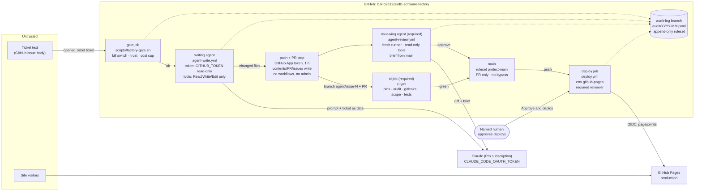

# Architecture

C4 level 2 (containers). Every arrow that crosses a trust boundary has a check, and every
box names the file that implements it.

## Where each agent holds a token

| Where | Token | Can | Cannot |
|---|---|---|---|
| Writing agent step | `GITHUB_TOKEN` (contents: read, issues: read) + Claude OAuth token | read the repo, call the model | push, comment, merge, deploy, read other secrets |
| Push + PR step (deterministic, not the model) | GitHub App installation token, 1 hour | push `agent/*` branches, open the PR, enable auto-merge, comment | push to `main` (ruleset, no bypass), change workflows (no `workflows` permission), deploy, administer the repo |
| Reviewing agent step | `GITHUB_TOKEN` (contents: read, pull-requests: write) + Claude OAuth token | read, post one review comment | push, approve, merge, deploy |
| Deploy job | OIDC + `pages: write` | publish the built site | run before a named person approves |
| Audit step | GitHub App token, contents: write only | append to `audit-log` | rewrite or delete history (ruleset) |
